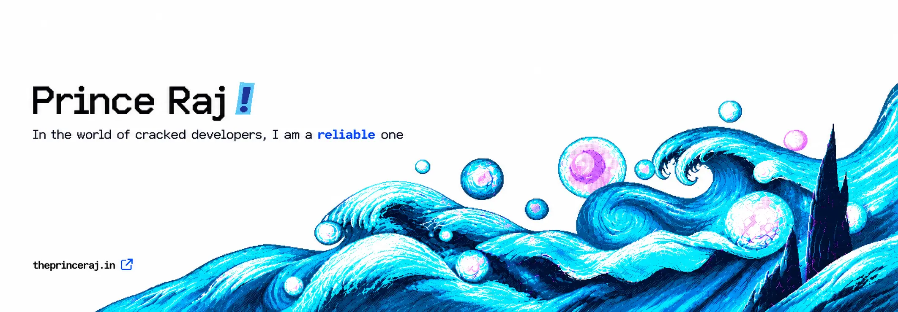

    
    
    

### About Me

    I’m Prince Raj, an engineering student and code enthusiast.  
    I enjoy solving real-world problems with code whether it's web apps, automation, or AI.  
    My tech playground includes NestJS, Firebase, ReactJS, and more.  
    Open to collaboration, new ideas, and building cool stuff together!  

### Languages, Tools and Technologies

• Languages

• Technologies

• Tools

### Github Stats:

    

### Connect With Me:

### Activity:

    

        
    

